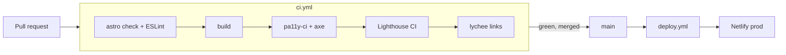

# portfolio-v3

Abdelrhman Fikri's portfolio, "Runbook" edition: one versioned engineering document (`AF-RB-001`) built with Astro 5, Tailwind CSS v4 and plain TypeScript. Static output, no UI framework.

## Commands

| Command | What it does |
| --- | --- |
| `npm run dev` | Local dev server |
| `npm run build` | Static build to `dist/` |
| `npm run check` | `astro check` and ESLint |
| `npm run test:a11y` | pa11y-ci, plus axe in light and dark at 1280px and 320px, against the built site |
| `npm run lhci` | Lighthouse CI, mobile and desktop, with a 95+ budget in all four categories |
| `npm run og` | Regenerates `public/og.png` |

`test:a11y` and `lhci` need Chrome. Set `PUPPETEER_EXECUTABLE_PATH` and `CHROME_PATH` to your Chrome binary if the bundled one isn't installed. Run `npm run build` first.

## Pipeline



Deploys come only from GitHub Actions. Netlify's own Git builds stay off. The footer shows the short commit SHA from `PUBLIC_COMMIT`.

### Secrets and settings

Add these in the repo settings before the first deploy:

- `NETLIFY_AUTH_TOKEN` and `NETLIFY_SITE_ID` as secrets on the `production` environment
- A branch protection rule on `main` that requires the `verify` job from CI

## Lighthouse scores

Measured locally with `npm run lhci` against the built site (home page and a case page).

| Form factor | Performance | Accessibility | Best practices | SEO |
| --- | --- | --- | --- | --- |
| Mobile | 97–100 | 100 | 100 | 100 |
| Desktop | 100 | 100 | 100 | 100 |

## Layout

```
src/
  components/   RunningHeader, Section, Sidenote, Plate, PostMortem, Figure, Redaction, ThemeToggle, CopyEmail, Footer
  figures/      Fig1SelfHealing.astro … Fig4Pipeline.astro (inline SVG, tokens only)
  content/work/ one MDX file per post-mortem
  data/site.ts  copy that is not a case study (from docs/COPY.md)
  layouts/      Doc.astro
  pages/        index.astro, work/[slug].astro, 404.astro
  styles/       tokens.css, global.css
public/         cv.pdf, favicon.svg, og.png, robots.txt, _headers
docs/           brief, copy, accessibility rules, build plan
reference/      the approved prototype and screenshots
```

## Rules

Read `CLAUDE.md` and `docs/` before changing anything. The short version: no client names, no invented facts, every colour from a token, both themes checked.

## Notes

- Figure SVG text is removed before the axe run, because axe can't resolve the colour of text drawn over SVG shapes. Those pairs are checked by hand: ink, muted and rubric on `--fig`, and ink on `--wash`, all at 4.9:1 or better in both themes.
- Newsreader is the static-weight variable font (`wght` axis only). The optical-size axis doubled the font payload and cost about 12 Lighthouse points on mobile.
